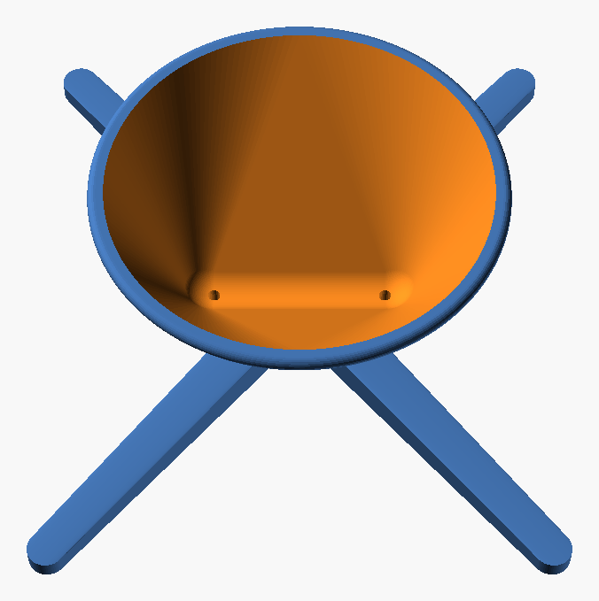
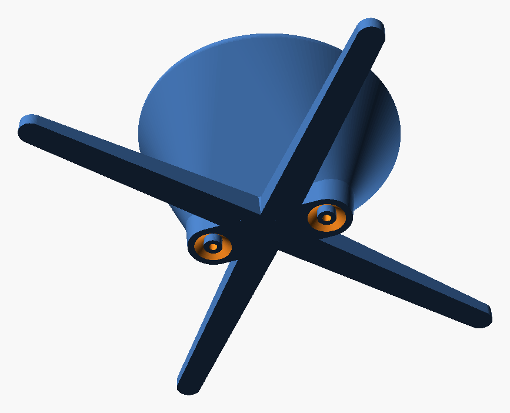

# 3D Espresso Splitter

A 3D-printable splitter for the Wacaco Picopresso (or any naked portafilter). It stands across two cups and divides one shot evenly between them, **wherever the coffee lands in the basin**.


## How it works

The splitter is one open basin on four legs. It has no hidden chambers and no inserts.

1. Coffee lands anywhere inside the 60 mm basin and runs down the smooth walls into a **level trough** at the bottom.
2. The trough has one **small outlet hole at each end**, one above each cup. Both holes are the same size and at the same height.
3. The holes are small enough that coffee builds up into a **shallow pool** (about 1 ml) in the trough. The surface of a pool is always level, so both holes have the same depth of coffee above them and pass the same flow. It doesn't matter where the coffee came from.
4. Under each hole, a small **drip tip** with a recess around it makes the coffee drop straight into the cup instead of running along the underside.


| Top | Bottom |
|---|---|
|  |  |

### How even is it?

These figures are estimates from orifice-flow calculations, not measurements. At normal Picopresso flow (1–2.5 ml/s), the pool is 2–14 mm deep. Tilting the splitter 1° shifts the split by only about 51/49 at those flows.

Two things matter in practice:

- **Level:** use two cups of the **same height** on a flat surface.
- **Hole size:** both outlet holes must be the **same size**. After printing, run a **2 mm drill bit** through both by hand.

## Specs

| | |
|---|---|
| Parts | 1, printed upright, no supports |
| Weight | about 27 g in PETG |
| Basin | 60 mm mouth, holds 41 ml up to the rim |
| Height | 34 mm above the cup rims |
| Footprint | 83 × 98 mm |
| Cups | any two cups of equal height, rim diameter about 45–90 mm, touching or up to about 15 mm apart |

The legs angle out at 50° from the line between the cups, so they rest on both cup rims across that whole range.

## Printing

| Setting | Value |
|---|---|
| File | `stl/splitter.stl`, already oriented |
| Material | **PETG** (or PCTG). Don't use PLA: it softens around 60 °C and fresh espresso is hotter. |
| Layer height | 0.2 mm |
| Walls | 3 |
| Infill | 20 % |
| Supports | None. No overhang is steeper than 45°. |

After printing, run a 2 mm drill bit through both outlet holes by hand so they are identical.

## Use

1. Stand the splitter across two cups, with one outlet over each cup. You can see the trough and both holes from above.
2. Hold the Picopresso anywhere over the basin and pull the shot.
3. Wait a few seconds for the trough to drain.
4. Rinse under the tap. Every surface is open and visible, so nothing is left to trap coffee. Clean the holes with a pipe cleaner if needed. Hand wash only, because dishwasher heat can warp PETG.

### Check the split with water

Pour 40 ml of water into different spots in the basin and weigh both cups.

- If one side always gets more, **turn the splitter 180°** and repeat.
- If the extra flow moves with the splitter, the holes differ in size. Drill both again.
- If the extra flow stays on the same side of the table, the cups or the table aren't level.

## Customising

Open `src/shot_splitter.scad` in [OpenSCAD](https://openscad.org) and change the values in the Customizer panel.

| Parameter | Default | Effect |
|---|---|---|
| `outlet_d` | 2.0 | Outlet hole size. Smaller builds a deeper pool, which gives a more even split but drains more slowly. |
| `outlet_x` | 14 | Distance of each hole from the centre. Increase it for cups with thick rims. |
| `mouth_d` | 60 | Basin mouth diameter |
| `leg_angle`, `leg_len` | 50, 60 | Leg direction and length. Adjust them for very small or very large cups. |

Export the STL:

```sh
openscad -o stl/splitter.stl src/shot_splitter.scad
```

To preview the splitter on two cups, use `-D 'part="preview"'`.
