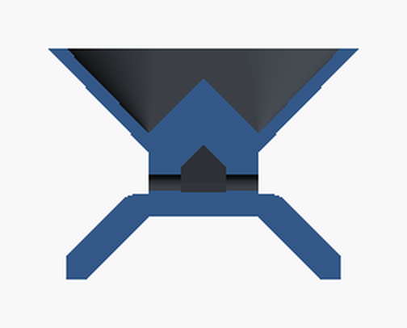
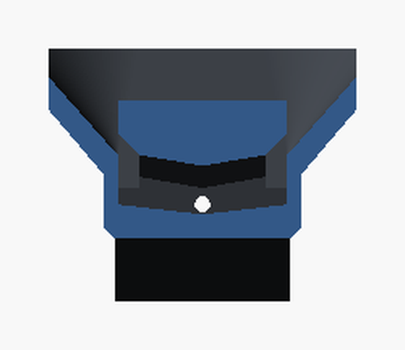

# 3D Espresso Splitter

A 3D-printable splitter for the Wacaco Picopresso, or any naked portafilter. It sits on two cups and divides one shot evenly between them, **wherever the coffee lands in the funnel**. It has no ball, no insert and no moving parts.


## How it works

1. A flat **ring** rests on the rims of two cups standing side by side. Four struts hold a 76 mm **funnel** above them.
2. Coffee poured anywhere into the funnel runs down to the bottom. There, two **1.6 mm bores** let it out, so it backs up into a **small pool** (about 1–3 ml during the shot).
3. The two bores sit **side by side on one straight line**, 10 mm apart, at the same height. The pool surface is level, so both bores have the same depth of coffee above them and pass the same flow, wherever the coffee came from.
4. A small **lid** covers the bores. No falling stream can hit them directly.
   - The pool reaches the bores only through a short channel (the "culvert") with **two inlet slots, one at each end**.
   - Both slots sit on the centre line between the cups and face sideways under a 45° hood.
   - So whatever happens at the pour, it reaches both bores the same way.
5. Each bore empties onto its **own chute**, which ends in a drip edge over its cup. After the split, the two sides share no surface.

| Cut through the bores (cups left and right) | Cut through the culvert (bore in the middle) |
|---|---|
|  |  |

| Top | Bottom |
|---|---|
|  |  |

### How even is it?

All numbers here are **estimates from flow calculations, not measurements**. Please test your print (see [Water test](#water-test)).

- **Level cups, pre-wetted:** about 50.7/49.3 is typical.
- **Pour position:** no straight-down stream can reach the culvert, and the inlets are mirror images. The estimated effect is under ±0.3 points.
- **Cup height:** if one cup is 1 mm taller, the splitter tilts about 0.7–1.1°. That shifts the split by 0.3 points or less at normal flow (1.2 ml/s and up), and by 1–2 points on a very slow shot (0.5 ml/s).
- **Front-to-back tilt:** no first-order effect, because both bores are at the same height on one line.
- **Hole size:** this matters most. Both bores must come out the **same size with the same edges**, so follow the drilling steps exactly. A 0.01 mm size difference is worth about 0.3 points.

For comparison, ordinary double spouts can be several grams apart between cups (Barista Hustle).

## Specs

| | |
|---|---|
| Parts | 1, printed upright, no supports |
| Weight | about 21 g in PETG |
| Size | 96 mm ring, 47.5 mm tall above the cup rims |
| Funnel | 76 mm mouth, holds 64 ml up to the rim |
| Cups | two cups of the same height, rim diameter about 55–85 mm, touching or a few mm apart |

## Printing

| Setting | Value |
|---|---|
| File | `stl/splitter.stl`, already oriented |
| Material | **PETG** or PCTG. Not PLA: it softens around 60 °C, and fresh espresso is hotter. |
| Layer height | 0.2 mm (0.16 mm gives a smoother funnel) |
| Walls | 3 |
| Supports | None. The only overhang is one 10 mm flat bridge under the keel, so keep bridging on. |
| Seam | Aligned or rear (the +Y side), away from the bores |
| Travel | Turn on "avoid crossing perimeters" (or combing) so no strings are left inside the culvert |

**Bed grip:** until the struts join the funnel at about 24 mm, the centre of the part stands only on the two small chute feet. Add small mouse-ear brim pads at the four corners of the chute feet. Keep them off the drip edges, the outer ends of the chutes. Print that height range a little slower.

## Drilling the bores (required)

The bores are printed as 1.4 mm pilot holes and drilled out to 1.6 mm by hand. Use **one 1.6 mm HSS drill bit** (DIN 338) in a **pin vise no wider than 12 mm**, and hold the splitter in your hand.

1. **Bore A:** put the drill into the pilot on one outer face of the keel, just above a chute. Drill straight along the cup axis until the tip just breaks into the culvert, then stop. Don't push on through to the other bore.
2. **Bore B:** do the same from the opposite outer face, with the same bit and the same number of turns.

Drilling each bore from its own side gives both inlets the same edge. A single pass through both would leave a burr on only one inlet, inside the culvert where you can't reach it.

3. **Clean the culvert:** pull a pipe cleaner in at one inlet slot, along the culvert and out at the other. This clears chips and strings.
4. **Deburr:** clean both outer bore edges the same way, for example with one light twist of a countersink each.
5. **Check:** hold it up to the light and look along the axis. You should see daylight through both bores.

## Use

1. **Place:** stand two cups of the same height next to each other on a level surface. Put the splitter on top with the **engraved arrows over the cup centres** and the **two notches on the line where the cups touch**.
2. **Pre-wet:** rinse it with hot water and give it one shake. Both bores then start wet, which matters for the first drops.
3. **Brew:** hold the Picopresso anywhere over the funnel, clear of the rim, and pull the shot.
4. **Wait:** let the funnel empty before you lift it. During fast pumping the funnel fills partly as a buffer, so the cups keep filling for up to about 15–20 s after the shot.

## Cleaning

- Rinse hot water through the funnel. It runs through the culvert and both bores.
- The culvert is a short channel (4 mm wide, about 11 mm roofed), open at both ends. Once a week, pull a pipe cleaner from slot to slot.
- Clean both bores with a fine interdental brush or pipe cleaner, the **same number of passes each side**. Oil films change how coffee wets the plastic, and the split relies on both sides behaving alike.
- Hand wash only. Dishwasher heat can warp PETG.

## Water test

Do this once after printing.

1. Use two identical cups on a level table, and a scale that reads to 0.1 g.
2. Pour 40 ml of hot water (80–85 °C):
   - slowly (about 0.5 ml/s), medium (1–1.5 ml/s) and fast (about 3 ml/s);
   - also through the Picopresso with an empty basket.
3. Repeat at different pour positions: centre, near each cup, front, back, and a deliberately wandering pour.
4. **Turn the splitter 180°** and repeat.
   - If the extra flow follows the splitter, the cause is the bores. Re-check the drilling and deburring. As a last resort, give the outer edge of the bore on the side that gets *less* one more light countersink twist.
   - If it stays on one side of the table, the cups or the table aren't level.
5. Optionally, put a 1 mm shim under one cup. Expect a shift of about 0.5 points or less.

**Target:** each cup within 49–51 % of the total.

## Customising

Open `src/shot_splitter.scad` in [OpenSCAD](https://openscad.org) and use the Customizer.

| Parameter | Default | Effect |
|---|---|---|
| `mouth_d` | 76 | Funnel mouth. Smaller is lighter (68 gives about 19 g, 46 ml and 43 mm height), with less room to aim. |
| `bore_d`, `pilot_d` | 1.6, 1.4 | Final and printed bore sizes. Larger bores drain faster but build a shallower pool, which is less tolerant of tilt. |
| `ring_r` | 46 | Ring radius. Larger gives a steadier stance on big cups. |
| `strut_angle` | 35 | Strut angle from the cup axis. Keep it away from 45 so the part only looks right one way round. |

Export the STL:

```sh
openscad -o stl/splitter.stl src/shot_splitter.scad
```

To preview it on two cups, add `-D 'part="preview"'`. `python3 tools/check_mesh.py` checks the result: one solid, overhangs, symmetry, drill access, line of sight and pool volume.

## Background

- **v1** dropped the stream onto a knife-edge ridge. At espresso flow rates coffee runs as a film down one side of the funnel, so the split followed the pour.
- **v2** used a level trough with two holes 28 mm apart. It was far more sensitive to tilt.
- **v3** keeps the pool idea. It brings the bores together on one axis, shields them from the stream, and matches their size by drilling.

The 35 mm steel ball in the Meticulous splitter is for extract chilling (the Hugh Kelly technique), not for splitting. A ball also passes the pour position straight through. So this design leaves it out.

More notes and the research behind the design are in [CONTEXT.md](CONTEXT.md).
