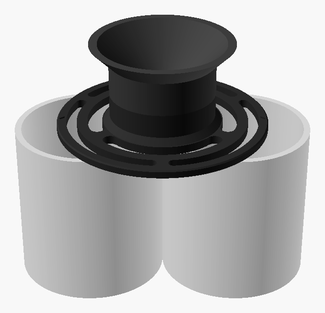
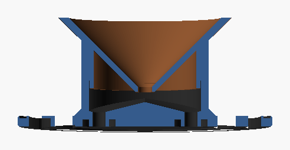
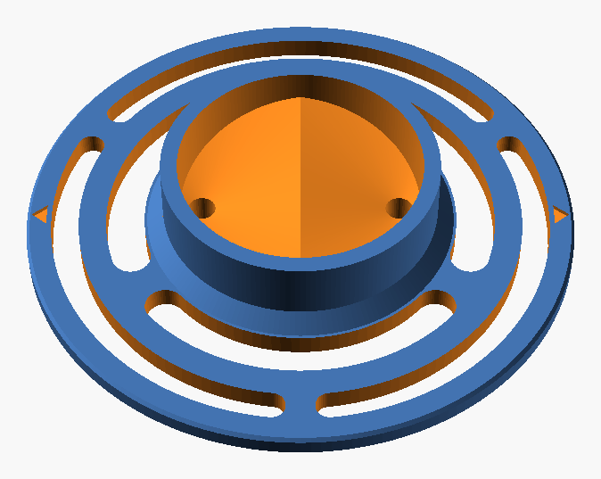

# Picopresso Shot Splitter

A 3D-printable shot splitter that sits across two cups and splits one espresso shot from a Wacaco Picopresso into both of them. It doesn't attach to the Picopresso: you hold the Picopresso over the funnel.



## How it works

1. The **round holder** rests on the rims of two cups standing side by side.
2. The **funnel** catches the shot (60 mm mouth) and narrows it into one stream through a 5.5 mm throat.
3. The stream falls onto a **ridge** in the bowl floor, which splits it into two halves. Each half drains to its own **nozzle**, one above each cup.
4. A small **drip-break gap** around each nozzle tip stops coffee from creeping along the underside, so it drips straight into the cup.



| Top | Bottom |
|---|---|
|  |  |

The arrows on the outer ring show where the nozzles are. Line them up with the two cups.

## Files

| File | What it is |
|---|---|
| `stl/base.stl` | Holder with splitter bowl and nozzles, already oriented for printing |
| `stl/funnel.stl` | Funnel, already oriented for printing (mouth down) |
| `src/shot_splitter.scad` | Parametric OpenSCAD source |

## Fit

- **Cups:** any two cups of the same height standing side by side, touching or up to about 20 mm apart. Rim diameters from about 50 mm to over 100 mm work, because the nozzles sit 18 mm from the centre, inside both cups.
- **Size:** 100 mm wide. The assembled splitter is 43 mm tall above the cup rims.
- **Even split:** the split is only even when the splitter is level, so use two cups of the same height on a flat surface.

## Printing

Both parts print **without supports**, in the orientation they're saved in.

| Setting | Value |
|---|---|
| Material | **PETG** (or PCTG). Don't use PLA, because it softens around 60 °C and fresh espresso is hotter. |
| Layer height | 0.2 mm |
| Walls | 3–4 |
| Infill | 20 % |
| Supports | None |
| Brim | Optional for the funnel (it stands on a 4 mm wide rim) |

Approximate filament use in PETG: base 44 g, funnel 27 g.

## Use and care

1. Put the base on two cups, with the arrows pointing at the cups.
2. Drop the funnel into the base bowl. The spigot centres it.
3. Hold the Picopresso over the funnel and pull the shot.
4. Lift the funnel out and rinse both parts. Hand wash only. Dishwasher heat can warp PETG.

## Customising

Open `src/shot_splitter.scad` in [OpenSCAD](https://openscad.org) and change the parameters in the Customizer panel. Useful ones:

| Parameter | Default | Effect |
|---|---|---|
| `disc_d` | 100 | Holder diameter |
| `outlet_x` | 18 | Nozzle distance from centre. Increase for wide cups, decrease for small ones. |
| `mouth_d` | 60 | Funnel mouth diameter |
| `throat_d` | 5.5 | Funnel throat. Smaller centres the stream better, larger flows faster. |
| `fit_clearance` | 0.3 | Gap between funnel spigot and bowl. Increase if the fit is too tight. |

Export STLs from the command line:

```sh
openscad -D 'part="base"'         -o stl/base.stl   src/shot_splitter.scad
openscad -D 'part="funnel_print"' -o stl/funnel.stl src/shot_splitter.scad
```

Use `part="assembly"` with `show_cups=true` to preview the parts on two cups.
